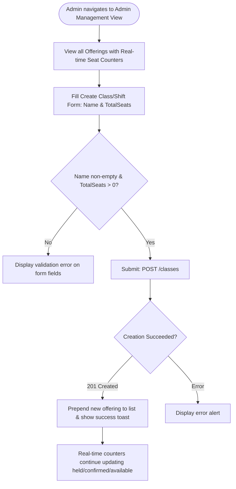
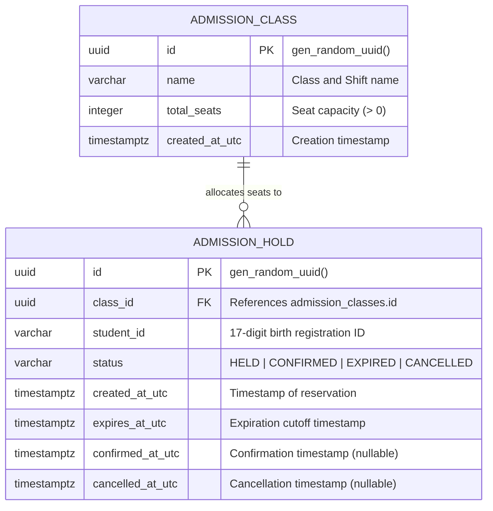
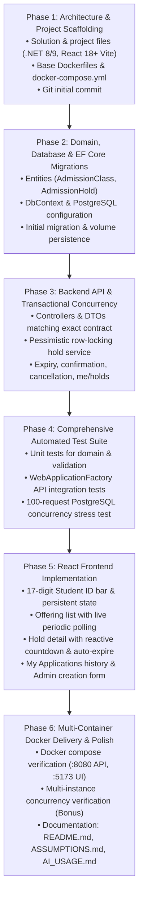

# School Admission System — Requirement Analysis & System Specification

**Project**: School Admission System (Take-Home Assignment for Assistant Software Engineer)  
**Organization**: Onnorokom Projukti Limited  
**Stack**: ASP.NET Core (.NET 8/9), PostgreSQL, EF Core, React 18+ (TypeScript, Vite), Docker Compose  
**Analysis Date**: November 9, 2026  
**Status**: Requirement Analysis & Architectural Specification (Pending User Approval)

---

## Decision Provenance Legend
Every requirement, constraint, architectural choice, and implementation decision in this document is tagged with its authoritative origin:
- `[Original Assignment]` — Explicitly mandated in `Asst_Software_Engineer_Project_Assignment.pdf`.
- `[Existing Documentation]` — Sourced from repository documents (`AGENTS.md`, `AGENT_INSTRUCTIONS.md`, `docs/*`, `ASSUMPTIONS.md`).
- `[Technical Recommendation]` — Industry best-practice proposed by the engineering agent to guarantee correctness, security, performance, and maintainability.

---

## 1. Functional Requirements

### 1.1 Class & Shift Management (School Admin)
- **FR-ADM-01**: Admin must be able to create an offering (class and shift combination) by supplying `name` and `totalSeats` via UI and API. `[Original Assignment §1.3, §1.4]`
- **FR-ADM-02**: Total seat capacity must be a positive integer greater than zero (`totalSeats > 0`). `[Technical Recommendation]`, `[Existing Documentation docs/04]`
- **FR-ADM-03**: Offering name must be non-empty and trimmed (e.g., "Class 6 – Morning Shift"). `[Original Assignment §1.3]`
- **FR-ADM-04**: Each class offering must be treated as an independent capacity domain even if the academic grade is identical (e.g., "Class 6 – Morning Shift" and "Class 6 – Day Shift" are two separate records). `[Original Assignment §1.3]`
- **FR-ADM-05**: System must list all created offerings with real-time aggregated metrics: `totalSeats`, `heldSeats`, `confirmedSeats`, and `availableSeats`. `[Original Assignment §1.4]`
- **FR-ADM-06**: System must provide detailed status of an individual offering by offering ID (`classId`). `[Original Assignment §1.4]`

### 1.2 Student Identity & Access (Parent)
- **FR-PAR-01**: No parent username/password login screen is required. `[Original Assignment §1.3]`
- **FR-PAR-02**: Student is identified exclusively by a 17-digit birth registration number entered into a persistent input field in the UI. `[Original Assignment §1.3]`
- **FR-PAR-03**: Frontend must transmit the student identity in HTTP requests using the custom header `X-Student-Id`. `[Original Assignment §1.4]`
- **FR-PAR-04**: Backend must validate that `X-Student-Id` consists of exactly 17 numeric digits; invalid or missing headers must be rejected with HTTP 400 Bad Request. `[Original Assignment §1.4]`, `[Existing Documentation docs/05]`
- **FR-PAR-05**: Frontend must persist the student identity locally (e.g., `localStorage`) so that page refreshes or reopened browser sessions keep the active student session intact. `[Original Assignment §1.5]`

### 1.3 Temporary Seat Reservation (Hold)
- **FR-HLD-01**: Parent can request a temporary seat hold on an available class offering via "আবেদন করুন" (Apply) button. `[Original Assignment §1.3]`
- **FR-HLD-02**: Seat holds are granted strictly on a First-Come, First-Served (FCFS) basis; no lottery algorithm is permitted. `[Original Assignment §1.1, §1.5]`
- **FR-HLD-03**: A single valid hold reserves exactly 1 seat. `[Original Assignment §1.1]`
- **FR-HLD-04**: The hold duration is configurable via environment variable `HOLD_DURATION_SECONDS` with a default of 600 seconds (10 minutes). `[Original Assignment §1.5]`
- **FR-HLD-05**: If available seats are 0 when a hold request is processed, backend must reject the request with HTTP 409 Conflict. `[Original Assignment §1.4, §1.5]`
- **FR-HLD-06**: A student can have at most one active application (`HELD`) or confirmed admission (`CONFIRMED`) in the same class offering simultaneously. `[Original Assignment §1.5]`
- **FR-HLD-07**: On successful hold creation, system responds with HTTP 201 Created containing `holdId`, `classId`, `studentId`, `status: "HELD"`, and ISO-8601 UTC timestamp `expiresAt`. `[Original Assignment §1.4]`

### 1.4 Hold Inspection & Live Status
- **FR-HLD-08**: Parent can view the status of an existing hold by `holdId`. `[Original Assignment §1.4]`
- **FR-HLD-09**: Valid hold lifecycle statuses are: `HELD`, `CONFIRMED`, `EXPIRED`, `CANCELLED`. `[Original Assignment §1.4]`
- **FR-HLD-10**: The UI must display an unexpired hold with a live countdown timer until `expiresAt`. `[Original Assignment §1.3]`
- **FR-HLD-11**: When the countdown timer reaches zero, the hold status in the UI must immediately transition to `EXPIRED` without requiring a page reload, and the "ভর্তি ফি দিন" (Pay Admission Fee) button must be disabled immediately. `[Original Assignment §1.5]`

### 1.5 Admission Confirmation & Payment Simulation
- **FR-CNF-01**: Parent confirms admission by clicking "ভর্তি ফি দিন" (Pay Admission Fee). `[Original Assignment §1.3]`
- **FR-CNF-02**: Actual third-party payment gateway integration is out of scope; clicking the confirm button directly simulates a successful payment. `[Original Assignment §1.3]`
- **FR-CNF-03**: Backend must verify that:
  1. The hold exists. `[Technical Recommendation]`
  2. The hold belongs to the requesting student (`X-Student-Id`). `[Original Assignment §1.5]`
  3. The hold is currently in `HELD` status. `[Original Assignment §1.5]`
  4. The current UTC time is strictly less than `expiresAt` (`nowUtc < expiresAt`). `[Original Assignment §1.5]`
- **FR-CNF-04**: On successful confirmation, hold status changes to `CONFIRMED`, capturing `confirmedAtUtc`. `[Original Assignment §1.4]`, `[Existing Documentation docs/04]`
- **FR-CNF-05**: Confirmation must be strictly idempotent: duplicate or repeated confirmation requests for the same hold must not increment `confirmedSeats` multiple times. `[Original Assignment §1.5]`

### 1.6 Hold Cancellation
- **FR-CNC-01**: Parent can cancel an active hold using the "বাতিল" (Cancel) button (`DELETE /holds/{holdId}`). `[Original Assignment §1.3, §1.4]`
- **FR-CNC-02**: Backend must verify student ownership via `X-Student-Id`. Only the owning student can cancel their hold. `[Original Assignment §1.5]`, `[Existing Documentation docs/05]`
- **FR-CNC-03**: Cancellation changes status to `CANCELLED` and immediately releases the reserved seat back to `availableSeats`. `[Original Assignment §1.1, §1.5]`
- **FR-CNC-04**: Backend responds with HTTP 204 No Content on successful cancellation. `[Original Assignment §1.4]`

### 1.7 Student Application History
- **FR-HIS-01**: Parent can navigate to "আমার আবেদন" (My Applications) (`GET /me/holds`) to view all past and present applications for their 17-digit student ID. `[Original Assignment §1.3, §1.4]`
- **FR-HIS-02**: Response returns an array of holds containing `holdId`, `classId`, `className`, `status`, and `expiresAt`. `[Original Assignment §1.4]`

### 1.8 Automatic Expiry & Capacity Reclamation
- **FR-EXP-01**: Expired holds must release their seat automatically without requiring an explicit background job or external API call. `[Original Assignment §1.5]`
- **FR-EXP-02**: Capacity formulas and transactional operations must evaluate whether `ExpiresAtUtc <= nowUtc` on the fly to guarantee zero stale locks. `[Original Assignment §1.5]`, `[Existing Documentation docs/06]`

---

## 2. Non-Functional Requirements

- **NFR-CON-01 (Absolute Non-Overselling Invariant)**: Under extreme concurrent load, the invariant `confirmedSeats + unexpiredHeldSeats <= totalSeats` must never be violated under any circumstance. `[Original Assignment §1.5]`
- **NFR-CON-02 (Multi-Process / Multi-Instance Scalability [Bonus])**: Concurrency protection must operate at the database tier (PostgreSQL row-level locking or atomic conditions), functioning flawlessly even when multiple backend instances run on separate ports/containers. `[Original Assignment §1.6]`, `[Existing Documentation AGENTS.md]`
- **NFR-PER-01 (High Throughput & Low Latency)**: Hold transactions must execute in minimal round-trips to prevent database lock contention under thousands of concurrent applicants. `[Technical Recommendation]`
- **NFR-DAT-01 (Data Durability & Persistence)**: Database must be persisted in a Docker named volume (`postgres_data`). No data loss can occur when restarting or taking containers down via `docker compose down`. `[Original Assignment §1.5]`
- **NFR-DAT-02 (UTC Timestamp Standard)**: All timestamps across PostgreSQL, ASP.NET Core, and JSON API payloads must be formatted in ISO-8601 UTC (`timestamp with time zone`). `[Existing Documentation AGENTS.md, ASSUMPTIONS.md]`
- **NFR-ERR-01 (Safe & Informative Error Responses)**:
  - Input validation failures, missing headers, or malformed payloads must return HTTP 4xx (never 500). `[Original Assignment §1.5]`
  - Sold-out seats or invalid state transitions return HTTP 409 Conflict. `[Original Assignment §1.4]`
  - Non-existent entities return HTTP 404 Not Found. `[Original Assignment §1.4]`
  - Internal server errors must never leak stack traces or connection strings to clients. `[Existing Documentation docs/05]`, `[Technical Recommendation]`
- **NFR-UI-01 (Live Capacity Polling)**: Class seat availability in the UI must auto-refresh every few seconds (e.g., 3–5s interval) without requiring manual page refresh. `[Original Assignment §1.5]`
- **NFR-UI-02 (Resilient UX & Error Communication)**:
  - Any error (sold out, expired, bad input, backend unreachable) must be displayed in clear human-readable language (English / Bengali context). `[Original Assignment §1.5]`
  - Blank pages or console-only error reporting are strictly forbidden. `[Original Assignment §1.5]`
  - Submit buttons must be disabled while requests are in-flight to prevent client-side double-submission. `[Existing Documentation docs/07]`
- **NFR-NET-01 (Strict Port Contract)**:
  - Backend API: `http://localhost:8080`. `[Original Assignment §1.2]`
  - Frontend UI: `http://localhost:5173`. `[Existing Documentation AGENTS.md]`
  - Frontend environment variable: `VITE_API_BASE_URL=http://localhost:8080`. `[Original Assignment §1.2]`
  - Never map frontend to port 8080 or swap host ports. `[Existing Documentation AGENTS.md]`
- **NFR-DOC-01 (Zero-Host Dependency Docker Delivery)**: The system must spin up completely via `docker compose up --build` without requiring host-installed .NET SDK, Node.js, or PostgreSQL. `[Original Assignment §1.2]`, `[Existing Documentation AGENT_INSTRUCTIONS.md]`

---

## 3. Parent User Journey

```mermaid
flowchart TD
    Start([Parent arrives at Landing Page]) --> InputID[Enter 17-digit Birth Registration Number]
    InputID --> ValidateID{Valid 17 Digits?}
    ValidateID -- No --> ShowInputError[Display validation message & disable actions]
    ValidateID -- Yes --> BrowseOfferings[Browse Class Offerings & Live Seat Counters]
    
    BrowseOfferings --> AutoPoll[Background Poller updates seat availability every 4s]
    BrowseOfferings --> ChooseOffering[Select Offering & Click 'আবেদন করুন / Apply']
    
    ChooseOffering --> HoldAPI[POST /classes/{id}/holds with X-Student-Id]
    HoldAPI --> HoldDecision{Available Seats > 0?}
    
    HoldDecision -- No (409 Conflict) --> ShowSoldOut[Show 'Sold Out / আসন শেষ' error banner]
    HoldDecision -- Already Holding (409) --> ShowDuplicate[Show 'Active hold or confirmed seat already exists']
    HoldDecision -- Yes (201 Created) --> HoldView[Display Hold Details & Live Expiry Countdown]
    
    HoldView --> ParentChoice{Parent Action}
    
    ParentChoice -- Wait / Time Runs Out --> TimerZero[Timer reaches 0:00]
    TimerZero --> ClientExpired[Status transitions to EXPIRED instantly without reload]
    ClientExpired --> DisablePay[Disable 'ভর্তি ফি দিন' button]
    
    ParentChoice -- Click 'বাতিল / Cancel' --> CancelAPI[DELETE /holds/{id}]
    CancelAPI --> CancelSuccess[Status updated to CANCELLED; Seat released]
    
    ParentChoice -- Click 'ভর্তি ফি দিন / Pay Fee' --> ConfirmAPI[POST /holds/{id}/confirm]
    ConfirmAPI --> CheckExpiryServer{Server Expiry Check}
    CheckExpiryServer -- Expired (409) --> ExpiryBanner[Show 'Hold expired; cannot confirm']
    CheckExpiryServer -- Valid (200) --> ConfirmedState[Status updated to CONFIRMED; Admission complete]
    
    BrowseOfferings -.-> ViewHistory[Click 'আমার আবেদন / My Applications']
    ViewHistory --> FetchHistory[GET /me/holds]
    FetchHistory --> ListHolds[Display history of HELD, CONFIRMED, EXPIRED, CANCELLED holds]
```

---

## 4. Admin User Journey



---

## 5. System Architecture

```mermaid
flowchart LR
    subgraph Client Tier
        Browser["Parent / Admin Web Browser"]
    end

    subgraph Docker Host Environment
        subgraph Port 5173
            FE["Frontend Container\n(React 18 + Vite / Nginx)\nStatic SPA Bundle"]
        end

        subgraph Port 8080
            BE["Backend API Container\n(ASP.NET Core Web API .NET 8/9)\nControllers / Application / Infrastructure"]
        end

        subgraph Port 5432 (Internal Docker Network)
            DB[("PostgreSQL 16 DB Container\nNamed Volume: postgres_data\nRow-Level Locking")]
        end
    end

    Browser -- "HTTP :5173 (UI)" --> FE
    Browser -- "HTTP :8080 (REST + X-Student-Id)" --> BE
    FE -- "Configured via VITE_API_BASE_URL" -.-> BE
    BE -- "Npgsql / EF Core Connection" --> DB
```

---

## 6. Backend Architecture (Modular Clean Architecture)

```
backend/
├── SchoolAdmission.Api/                  # Presentation Layer
│   ├── Controllers/
│   │   ├── ClassesController.cs         # /classes endpoints
│   │   ├── HoldsController.cs           # /holds endpoints
│   │   └── MeController.cs              # /me/holds endpoint
│   ├── Middleware/
│   │   ├── ExceptionHandlingMiddleware.cs # Global RFC 7807 error format
│   │   └── StudentIdValidationFilter.cs # X-Student-Id header validator
│   ├── Program.cs                       # Dependency Injection, Middleware pipeline, CORS
│   └── appsettings.json                 # Connection strings, HOLD_DURATION_SECONDS
│
├── SchoolAdmission.Application/          # Application / Use Case Layer
│   ├── DTOs/                            # Requests and Responses
│   ├── Interfaces/                      # IAdmissionService, IHoldService
│   ├── Services/                        # Business orchestration & validations
│   └── Validators/                      # FluentValidation / DataAnnotations
│
├── SchoolAdmission.Domain/               # Core Domain Layer (No external dependencies)
│   ├── Entities/
│   │   ├── AdmissionClass.cs            # Offering aggregate root
│   │   └── AdmissionHold.cs             # Hold entity & state machine
│   ├── Enums/
│   │   └── HoldStatus.cs                # HELD, CONFIRMED, EXPIRED, CANCELLED
│   └── Exceptions/                      # Domain-specific exceptions (ConflictException, etc.)
│
└── SchoolAdmission.Infrastructure/       # Infrastructure & Persistence Layer
    ├── Data/
    │   ├── AdmissionDbContext.cs        # EF Core DbContext with model configurations
    │   └── Migrations/                  # Repeatable EF Core PostgreSQL migrations
    ├── Repositories/                    # Atomic database operations with SELECT FOR UPDATE
    └── BackgroundServices/              # Optional lazy status sync worker
```

`[Technical Recommendation]`: Separation into clean layers guarantees testability, isolates domain logic, enables mock-free integration testing with WebApplicationFactory, and keeps EF Core mapping details out of the controllers.

---

## 7. Frontend Architecture (React 18 + TypeScript + Vite)

```
frontend/
├── src/
│   ├── assets/                          # Icons, styles
│   ├── components/                      # Reusable UI components
│   │   ├── Common/
│   │   │   ├── Header.tsx               # Student ID bar, navigation tabs, connection status
│   │   │   ├── CountdownTimer.tsx       # Live mm:ss countdown component
│   │   │   ├── StatusBadge.tsx          # Color-coded badges for HELD/CONFIRMED/EXPIRED/CANCELLED
│   │   │   └── ErrorAlert.tsx           # User-friendly error alert box
│   │   ├── Parent/
│   │   │   ├── OfferingCard.tsx         # Offering card with seat gauge & "Apply" action
│   │   │   ├── OfferingList.tsx         # Grid of offerings with auto-refresh
│   │   │   ├── HoldDetailModal.tsx      # Hold summary, countdown, confirm/cancel buttons
│   │   │   └── MyHoldsTable.tsx         # Historical table of student applications
│   │   └── Admin/
│   │       ├── CreateClassForm.tsx      # Name & totalSeats creation form
│   │       └── AdminDashboard.tsx       # Capacity oversight dashboard
│   ├── context/
│   │   └── StudentContext.tsx           # Context providing persistent 17-digit studentId
│   ├── hooks/
│   │   ├── usePolling.ts                # Interval fetcher with cleanup
│   │   └── useOfferings.ts              # Offerings state & actions
│   ├── services/
│   │   └── api.ts                       # Axios/Fetch client injecting X-Student-Id and baseURL
│   ├── types/
│   │   └── index.ts                     # TypeScript interfaces matching API DTOs
│   ├── App.tsx                          # Tabbed layout (Offerings, My Applications, Admin)
│   └── main.tsx                         # Entry point with global CSS
├── .env.example                         # VITE_API_BASE_URL=http://localhost:8080
├── Dockerfile                           # Multi-stage build (Node build -> Nginx / Vite preview)
└── package.json
```

`[Technical Recommendation]`: Lightweight, zero unnecessary complexity. A single-page application with accessible tabs gives instant access to parent and admin workflows without complex router overhead, while preserving full capability and reactive countdowns.

---

## 8. PostgreSQL Database Design

### 8.1 Table: `admission_classes` (Offering)
| Column Name | Data Type | Constraints | Description | Provenance |
| :--- | :--- | :--- | :--- | :--- |
| `id` | `uuid` | `PRIMARY KEY, DEFAULT gen_random_uuid()` | Unique class/shift offering identifier | `[Original Assignment §1.4]`, `[Existing Documentation docs/04]` |
| `name` | `varchar(150)` | `NOT NULL` | Class offering title (e.g., "Class 6 – Morning Shift") | `[Original Assignment §1.3, §1.4]` |
| `total_seats` | `integer` | `NOT NULL, CHECK (total_seats > 0)` | Total seats allocated to this class/shift | `[Original Assignment §1.3]`, `[Existing Documentation docs/04]` |
| `created_at_utc` | `timestamptz` | `NOT NULL, DEFAULT CURRENT_TIMESTAMP` | Record creation audit timestamp in UTC | `[Existing Documentation docs/04]` |

### 8.2 Table: `admission_holds` (Reservation / Admission)
| Column Name | Data Type | Constraints | Description | Provenance |
| :--- | :--- | :--- | :--- | :--- |
| `id` | `uuid` | `PRIMARY KEY, DEFAULT gen_random_uuid()` | Unique hold/application identifier | `[Original Assignment §1.4]` |
| `class_id` | `uuid` | `NOT NULL, REFERENCES admission_classes(id) ON DELETE RESTRICT` | Foreign key referencing the offering | `[Original Assignment §1.4]` |
| `student_id` | `varchar(17)` | `NOT NULL, CHECK (length(student_id) = 17)` | 17-digit birth registration number | `[Original Assignment §1.4]` |
| `status` | `varchar(20)` | `NOT NULL, CHECK (status IN ('HELD', 'CONFIRMED', 'EXPIRED', 'CANCELLED'))` | Application lifecycle status | `[Original Assignment §1.4]` |
| `created_at_utc` | `timestamptz` | `NOT NULL, DEFAULT CURRENT_TIMESTAMP` | Time hold was generated (UTC) | `[Existing Documentation docs/04]` |
| `expires_at_utc` | `timestamptz` | `NOT NULL` | Expiry cutoff time (`created_at_utc + hold_duration`) | `[Original Assignment §1.4, §1.5]` |
| `confirmed_at_utc` | `timestamptz` | `NULL` | Timestamp of confirmation | `[Existing Documentation docs/04]` |
| `cancelled_at_utc` | `timestamptz` | `NULL` | Timestamp of cancellation | `[Existing Documentation docs/04]` |

### 8.3 Indexes & Performance Optimizations
1. **Capacity Aggregation Index**:
   `CREATE INDEX idx_holds_class_status_expiry ON admission_holds (class_id, status, expires_at_utc);`  
   *Justification*: Accelerates real-time count of active `HELD` and `CONFIRMED` seats while offering row is locked. `[Existing Documentation docs/04]`
2. **Student Hold Lookup Index**:
   `CREATE INDEX idx_holds_student_created ON admission_holds (student_id, created_at_utc DESC);`  
   *Justification*: Optimizes `GET /me/holds` query for rapid parent history retrieval. `[Existing Documentation docs/04]`
3. **Active Hold Duplicate Prevention**:
   Enforced inside the row-locked transaction: `SELECT EXISTS(...) WHERE class_id = @id AND student_id = @student AND (status = 'CONFIRMED' OR (status = 'HELD' AND expires_at_utc > @nowUtc))`. `[Original Assignment §1.5]`, `[Technical Recommendation]`

---

## 9. Entity Relationships



---

## 10. API Endpoint Mapping

| # | HTTP Method | Path | Required Headers | Request Payload | Response Status & Body | Error Codes | Provenance |
| :- | :--- | :--- | :--- | :--- | :--- | :--- | :--- |
| 1 | `POST` | `/classes` | `Content-Type: application/json` | `{"name": "Class 6 - Morning Shift", "totalSeats": 120}` | `201 Created`<br>`{"id": "uuid", "name": "...", "totalSeats": 120}` | 400 Bad Request (invalid name or totalSeats <= 0) | `[Original Assignment §1.4]` |
| 2 | `GET` | `/classes` | None | None | `200 OK`<br>`[{"id": "uuid", "name": "...", "totalSeats": 120, "heldSeats": 15, "confirmedSeats": 80, "availableSeats": 25}]` | None | `[Original Assignment §1.4]` |
| 3 | `GET` | `/classes/{classId}` | None | None | `200 OK`<br>`{"id": "uuid", "name": "...", "totalSeats": 120, "heldSeats": 15, "confirmedSeats": 80, "availableSeats": 25}` | 404 Not Found (invalid classId) | `[Original Assignment §1.4]` |
| 4 | `POST` | `/classes/{classId}/holds` | `X-Student-Id: {17-digits}` | Empty `{}` | `201 Created`<br>`{"holdId": "uuid", "classId": "uuid", "studentId": "...", "status": "HELD", "expiresAt": "2026-11-09T10:10:00Z"}` | 400 (bad student ID), 404 (class not found), 409 (sold out OR duplicate active hold) | `[Original Assignment §1.4, §1.5]` |
| 5 | `GET` | `/holds/{holdId}` | None | None | `200 OK`<br>`{"holdId": "uuid", "classId": "uuid", "status": "HELD", "expiresAt": "2026-11-09T10:10:00Z"}` | 404 Not Found | `[Original Assignment §1.4]` |
| 6 | `POST` | `/holds/{holdId}/confirm` | `X-Student-Id: {17-digits}` | None | `200 OK`<br>`{"holdId": "uuid", "status": "CONFIRMED"}` | 400 (bad header), 403/404 (not owner/not found), 409 (expired or cancelled) | `[Original Assignment §1.4, §1.5]` |
| 7 | `DELETE`| `/holds/{holdId}` | `X-Student-Id: {17-digits}` | None | `204 No Content` | 400 (bad header), 403/404 (not owner/not found), 409 (already confirmed) | `[Original Assignment §1.4, §1.5]` |
| 8 | `GET` | `/me/holds` | `X-Student-Id: {17-digits}` | None | `200 OK`<br>`[{"holdId": "uuid", "classId": "uuid", "className": "...", "status": "HELD", "expiresAt": "..."}]` | 400 Bad Request (missing or invalid 17-digit header) | `[Original Assignment §1.4]` |

> [!IMPORTANT]
> Contract compliance rule: Response field names must strictly match the assignment examples (`id`, `name`, `totalSeats`, `heldSeats`, `confirmedSeats`, `availableSeats`, `holdId`, `classId`, `studentId`, `status`, `expiresAt`, `className`). Extra fields may be included if necessary, but none of these specified fields can be omitted or renamed. `[Original Assignment §1.4]`

---

## 11. Seat Allocation and Concurrency Strategy

### 11.1 The Core Concurrency Problem
When thousands of parents apply simultaneously for the remaining 5 seats in a class, standard read-then-write logic creates a classic race condition:
1. Process A reads `availableSeats = 1`.
2. Process B reads `availableSeats = 1`.
3. Process A inserts Hold A.
4. Process B inserts Hold B.
*Result*: 2 seats reserved when only 1 was available — **Overselling**.

### 11.2 PostgreSQL Row-Level Locking (`SELECT ... FOR UPDATE`)
To prevent overselling across single or multiple backend processes `[Original Assignment §1.5, §1.6]`:
1. **Begin Explicit Transaction**: Isolation level set to `Read Committed`.
2. **Pessimistic Offering Lock**:
   ```sql
   SELECT id, total_seats FROM admission_classes WHERE id = @classId FOR UPDATE;
   ```
   - This places an exclusive row-level lock on the specific `admission_classes` row.
   - Any other concurrent request for the same class (on *any* API server process or thread) is forced into a queue at the database engine level until this transaction commits or rolls back.
3. **Capture Accurate `nowUtc`**: Captured *after* obtaining the lock so lock-wait latency does not consume hold time.
4. **Evaluate Active Seat Reservations**:
   ```sql
   SELECT 
       COUNT(*) FILTER (WHERE status = 'CONFIRMED') AS confirmed_count,
       COUNT(*) FILTER (WHERE status = 'HELD' AND expires_at_utc > @nowUtc) AS held_count
   FROM admission_holds
   WHERE class_id = @classId;
   ```
5. **Verify Single Active Student Policy**:
   Check if the requesting `student_id` already has a `CONFIRMED` hold or an unexpired `HELD` hold in this class. If found, abort with HTTP 409 Conflict ("Student already holds a seat in this class").
6. **Evaluate Availability**:
   If `confirmed_count + held_count >= total_seats`:
   Roll back transaction and immediately return **HTTP 409 Conflict** (`"No seats available"`).
7. **Insert Reservation**:
   Insert new record with `status = 'HELD'`, `created_at_utc = @nowUtc`, and `expires_at_utc = @nowUtc + interval '@holdDurationSeconds seconds'`.
8. **Commit Transaction**: Row lock is released; the next queued request in line evaluates the updated count.

```mermaid
sequenceDiagram
    autonumber
    actor ParentA as Parent A (Process 1)
    actor ParentB as Parent B (Process 2)
    participant BE1 as Backend API 1
    participant BE2 as Backend API 2
    participant PG as PostgreSQL Engine

    ParentA->>BE1: POST /classes/{id}/holds (X-Student-Id: 11111111111111111)
    ParentB->>BE2: POST /classes/{id}/holds (X-Student-Id: 22222222222222222)
    
    BE1->>PG: BEGIN TX; SELECT ... FOR UPDATE (id={id})
    activate PG
    Note over PG: Lock acquired by TX 1
    BE2->>PG: BEGIN TX; SELECT ... FOR UPDATE (id={id})
    Note over PG: TX 2 WAITS for lock on row {id}

    BE1->>PG: Count CONFIRMED + unexpired HELD
    PG-->>BE1: Count = 9, Capacity = 10 (1 seat free)
    BE1->>PG: INSERT INTO admission_holds (HELD, expiresAt=now+600)
    BE1->>PG: COMMIT TX 1
    deactivate PG
    BE1-->>ParentA: 201 Created (Hold Granted)

    activate PG
    Note over PG: TX 2 now acquires lock on row {id}
    BE2->>PG: Count CONFIRMED + unexpired HELD
    PG-->>BE2: Count = 10, Capacity = 10 (0 seats free)
    BE2->>PG: ROLLBACK TX 2
    deactivate PG
    BE2-->>ParentB: 409 Conflict (Sold Out)
```

### 11.3 Why In-Memory Locks (e.g. `SemaphoreSlim`) Fail
- `SemaphoreSlim` only coordinates threads inside a *single .NET process*.
- The assignment explicitly specifies multi-process execution (Bonus §1.6) and high-availability scenarios where multiple container replicas run simultaneously.
- PostgreSQL row-level locking ensures atomicity directly at the single source of truth across unlimited application instances. `[Existing Documentation AGENTS.md, docs/06]`

---

## 12. Docker Architecture

### 12.1 Compose Services Specification (`docker-compose.yml`)
1. **`db` (Database Service)**:
   - Image: `postgres:16-alpine`
   - Environment: `POSTGRES_DB=school_admission`, `POSTGRES_USER=postgres`, `POSTGRES_PASSWORD=postgres`
   - Volume: `postgres_data:/var/lib/postgresql/data` (Named volume ensuring data survives container restarts/downs)
   - Healthcheck: `pg_isready -U postgres -d school_admission` (Interval: 3s, timeout: 3s, retries: 5)
   - Ports: `5432:5432` (Optional host exposure for local tooling, internal network for backend)
2. **`backend` (API Service)**:
   - Build: `context: ./backend`, `dockerfile: Dockerfile`
   - Depends On: `db` with `condition: service_healthy`
   - Environment:
     - `ConnectionStrings__DefaultConnection=Host=db;Port=5432;Database=school_admission;Username=postgres;Password=postgres`
     - `HOLD_DURATION_SECONDS=600`
     - `ASPNETCORE_URLS=http://+:8080`
     - `ASPNETCORE_ENVIRONMENT=Development`
   - Ports: `8080:8080` (`http://localhost:8080`)
3. **`frontend` (Web UI Service)**:
   - Build: `context: ./frontend`, `dockerfile: Dockerfile`
   - Depends On: `backend`
   - Environment:
     - `VITE_API_BASE_URL=http://localhost:8080`
   - Ports: `5173:80` (or `5173:5173` via Vite preview/Nginx) (`http://localhost:5173`)

### 12.2 Port Isolation Verification
- API host port: **8080**
- Frontend host port: **5173**
- Frontend container never binds to 8080; API never binds to 5173. `[Existing Documentation AGENTS.md]`

---

## 13. Security Considerations

- **SEC-01 (Birth Registration Validation)**: Strict regex enforcement `^\d{17}$` preventing SQL injection, header manipulation, or arbitrary strings in `X-Student-Id`. `[Original Assignment §1.4]`
- **SEC-02 (Horizontal Privilege & Student Ownership)**: Holds can only be confirmed or cancelled if the requesting `X-Student-Id` exactly matches the `student_id` recorded on the hold. Attempts by other student IDs result in rejection. `[Original Assignment §1.5]`
- **SEC-03 (Parameterized Database Queries)**: All database interactions utilize EF Core or parameterized SQL (`NpgsqlCommand` with typed parameters), immune to SQL injection. `[Technical Recommendation]`
- **SEC-04 (CORS Policy)**: Backend configures CORS specifically allowing origins `http://localhost:5173` and local dev networks, exposing `X-Student-Id` in allowed headers. `[Technical Recommendation]`
- **SEC-05 (Production Admin Notice)**: The assignment does not specify admin authentication. The admin interface will be provided for evaluation convenience, but clearly documented in `ASSUMPTIONS.md` and `README.md` that production deployment requires ASP.NET Core Identity / OAuth2 authentication. `[Existing Documentation ASSUMPTIONS.md]`
- **SEC-06 (No Secret Leakage)**: Passwords and configuration will use environment variables; `.env.example` will contain only placeholders. `[Existing Documentation AGENTS.md]`

---

## 14. Automated Testing Strategy

### 14.1 Unit Testing (Domain & Application)
- **Class Offering Logic**: Validate name non-empty, seat capacity positive, zero or negative seats rejected.
- **Seat Counter Formula**: Validate `available = max(0, total - confirmed - activeHeld)`.
- **Expiry Calculations**: Validate that past `expiresAt` is evaluated as expired.
- **Header Filter**: Verify valid 17 digits pass, 16 digits, 18 digits, letters, or null fail.

### 14.2 API Integration Testing (WebApplicationFactory)
- `POST /classes` creates class and returns 201.
- `GET /classes` lists offerings with counter fields.
- `POST /classes/{id}/holds` creates hold and returns 201.
- `POST /holds/{id}/confirm` transitions hold to CONFIRMED.
- `DELETE /holds/{id}` cancels hold and returns 204.
- `GET /me/holds` filters holds by student ID.

### 14.3 Mandatory Concurrency Stress Test (PostgreSQL-backed)
- **Requirement**: As specified in `Original Assignment §1.7`, `AGENT_INSTRUCTIONS.md §10`, and `docs/08`.
- **Parameters**:
  - Target class capacity: **10 seats**.
  - Total concurrent requests: **100 simultaneous tasks**.
  - Student IDs: **100 unique valid 17-digit IDs**.
- **Expected Results**:
  - Exactly **10 requests** return `201 Created`.
  - Exactly **90 requests** return `409 Conflict`.
  - Database verification query proves: `confirmed_seats + held_seats <= 10`.
  - Zero `500 Internal Server Error` responses.

---

## 15. Potential Technical Risks & Mitigation Strategies

| # | Technical Risk | Potential Impact | Proven Mitigation Strategy |
| :- | :--- | :--- | :--- |
| 1 | **Database Deadlocks under Heavy Concurrency** | Transactions aborting with 500 errors during high-frequency hold requests. | Always acquire locks in uniform order (`admission_classes` first by primary key). Use explicit row-level `SELECT ... FOR UPDATE` on the offering row. `[Technical Recommendation]` |
| 2 | **Clock Drift / Inconsistent Expiry** | Discrepancies between application server time and database time causing premature or late hold expiration. | Standardize all timestamp creation and comparison exclusively on UTC (`DateTime.UtcNow` / PostgreSQL `NOW() AT TIME ZONE 'UTC'`). `[Existing Documentation AGENTS.md]` |
| 3 | **Stale UI Seat Counters** | Parents clicking "Apply" on offerings that appear open but are already sold out. | Implement client-side periodic polling (every 3–5 seconds) plus instant optimistic counter updates upon local hold/cancel/confirm actions. Handle 409 responses gracefully with clear error banners. `[Original Assignment §1.5]` |
| 4 | **Connection Pool Exhaustion** | 100 concurrent requests holding DB connections too long while waiting for row locks. | Keep the critical locked section ultra-lean: acquire lock, run single indexed aggregation query, perform insert, commit immediately. `[Technical Recommendation]` |
| 5 | **Double Confirmation Race Condition** | Parent double-clicking "ভর্তি ফি দিন" rapidly sending concurrent confirm requests. | Disable confirm button on first click (loading state); backend confirm transaction checks state atomically (`WHERE id = @holdId AND status = 'HELD'`) ensuring idempotent single increment. `[Original Assignment §1.5]` |

---

## 16. Missing Requirements & Conflicting Assumptions Clarifications

| # | Topic / Area | Assignment Brief (§) | Documentation Pack | Agent Resolution & Recommendation | Provenance |
| :- | :--- | :--- | :--- | :--- | :--- |
| 1 | **Admin Authentication** | Not specified in assignment. Admin screen just creates class. | Noted in `ASSUMPTIONS.md` that admin auth is omitted. | Implement a dedicated tab/view for School Admin in the React UI without password barrier; explicitly document in `ASSUMPTIONS.md` that production environments require authentication. | `[Existing Documentation ASSUMPTIONS.md]` |
| 2 | **Academic Year Attribute** | Mentioned generally ("নতুন শিক্ষাবর্ষে"), but not in `POST /classes` API contract. | Excluded from `POST /classes` contract. | Keep `POST /classes` strictly compliant with `{ "name": "...", "totalSeats": 120 }`. Class name can encompass year if desired (e.g., "Class 6 Morning 2026"). | `[Original Assignment §1.4]` |
| 3 | **Hold Duration Unit & Source** | Spec specifies `HOLD_DURATION_SECONDS` environment variable (default 600). | Assumed 10 minutes default. | Read `HOLD_DURATION_SECONDS` from environment configuration, defaulting to 600 seconds. | `[Original Assignment §1.5]` |
| 4 | **Auto-Release Architecture** | Spec states: "seats automatically return without needing API calls". | Debated whether background worker is needed. | Primary seat availability query dynamically ignores holds where `expires_at_utc <= nowUtc`. This guarantees real-time seat recovery without any delay. A lightweight background service can periodically mark stale records as `EXPIRED` for clean database reporting. | `[Original Assignment §1.5]`, `[Technical Recommendation]` |
| 5 | **Payment Gateway Integration** | Spec states: "clicking button simulates successful payment; no real gateway". | Matches assignment. | Simulated client-side and server-side state transition directly to `CONFIRMED`. | `[Original Assignment §1.3]` |

---

## 17. Requirement Traceability Matrix (RTM)

| Req ID | Requirement Description | Authoritative Source | Planned Implementation Component | Verification & Test Method |
| :--- | :--- | :--- | :--- | :--- |
| **REQ-01** | Admin creates class/shift offering | Original Assignment §1.3, §1.4 | `POST /classes`, `ClassesController.CreateClass` | Integration Test: `CreateClass_Returns201` |
| **REQ-02** | List offerings with seat counters | Original Assignment §1.4 | `GET /classes`, `ClassesController.GetClasses` | Integration Test: `GetClasses_IncludesAccurateCounters` |
| **REQ-03** | Get single offering details | Original Assignment §1.4 | `GET /classes/{classId}`, `ClassesController.GetById` | Integration Test: `GetClassById_ReturnsDetails` |
| **REQ-04** | 17-digit student ID validation | Original Assignment §1.4 | `StudentIdValidationFilter`, `Regex("^[0-9]{17}$")` | Unit Test: `ValidateStudentId_RejectsInvalidFormats` |
| **REQ-05** | Temporary seat reservation (Hold) | Original Assignment §1.4 | `POST /classes/{id}/holds`, `HoldService.CreateHold` | Integration Test: `CreateHold_Returns201_WithExpiresAt` |
| **REQ-06** | No overselling under concurrency | Original Assignment §1.5 | `SELECT ... FOR UPDATE` in PostgreSQL transaction | Concurrency Test: `100ConcurrentHolds_Capacity10_SucceedsExactly10` |
| **REQ-07** | Configurable hold duration | Original Assignment §1.5 | `HOLD_DURATION_SECONDS` environment variable | Unit Test: `HoldDuration_AppliesConfiguredSeconds` |
| **REQ-08** | Return HTTP 409 when sold out | Original Assignment §1.4, §1.5 | `HoldService.CreateHold` capacity check | Integration Test: `CreateHold_WhenFull_Returns409Conflict` |
| **REQ-09** | Prevent duplicate active holds | Original Assignment §1.5 | Transactional student existence check | Integration Test: `CreateHold_DuplicateStudent_Returns409` |
| **REQ-10** | Inspect hold status | Original Assignment §1.4 | `GET /holds/{holdId}`, `HoldsController.GetHold` | Integration Test: `GetHold_ReturnsStatusAndExpiry` |
| **REQ-11** | Confirm admission (simulated pay) | Original Assignment §1.4, §1.5 | `POST /holds/{id}/confirm`, `HoldService.ConfirmHold`| Integration Test: `ConfirmHold_Valid_ReturnsConfirmed` |
| **REQ-12** | Reject confirmation after expiry | Original Assignment §1.5 | Server UTC timestamp comparison (`nowUtc >= expiresAt`) | Unit & Integration Test: `ConfirmHold_Expired_Returns409` |
| **REQ-13** | Idempotent confirmation | Original Assignment §1.5 | Check status before incrementing counter | Integration Test: `ConfirmHold_Twice_IncrementsOnlyOnce` |
| **REQ-14** | Cancel hold | Original Assignment §1.4 | `DELETE /holds/{holdId}`, `HoldService.CancelHold` | Integration Test: `CancelHold_ReleasesSeatCapacity` |
| **REQ-15** | Student holds history | Original Assignment §1.4 | `GET /me/holds`, `MeController.GetMyHolds` | Integration Test: `GetMyHolds_FiltersByStudentId` |
| **REQ-16** | Automatic expiry seat return | Original Assignment §1.5 | Dynamic query exclusion `ExpiresAtUtc > nowUtc` | Unit Test: `ExpiredHolds_DoNotConsumeAvailableSeats` |
| **REQ-17** | UI live countdown & auto-expire | Original Assignment §1.5 | React `CountdownTimer.tsx`, state transition | Component Test / Manual verification |
| **REQ-18** | UI auto-refresh seat counters | Original Assignment §1.5 | React polling hook `usePolling.ts` | Frontend Component / Verification |
| **REQ-19** | Full Docker Compose delivery | Original Assignment §1.2 | `docker-compose.yml`, `backend/Dockerfile`, `frontend/Dockerfile` | Docker Test: `docker compose config` & `docker compose up --build` |
| **REQ-20** | Multi-process DB concurrency [Bonus] | Original Assignment §1.6 | PostgreSQL database-level row locks | Dual-instance test script against shared DB |

---

## 18. Phased Implementation Plan

In strict compliance with **Supervised Development Rules**, implementation will proceed phase by phase. Each phase will be presented with planned changes and will only proceed upon your explicit approval.



### Detailed Phase Breakdown:
1. **Phase 1: Project Scaffolding & Solution Setup**
   - Create ASP.NET Core Web API solution (`SchoolAdmissionSystem.sln`) with clean architecture folders (`Api`, `Application`, `Domain`, `Infrastructure`, `Tests`).
   - Create React 18+ TypeScript application with Vite in `frontend/`.
   - Setup initial `docker-compose.yml` linking `db`, `backend`, and `frontend`.
   - Setup `.editorconfig`, `.gitignore`, and configuration templates.
2. **Phase 2: Domain Modeling & Database Persistence**
   - Define entities: `AdmissionClass`, `AdmissionHold`, `HoldStatus`.
   - Configure EF Core Fluent API mappings, column types (`timestamptz`), check constraints, and composite indexes.
   - Generate initial EF Core migration.
   - Verify PostgreSQL container initialization and persistence via named volume.
3. **Phase 3: Backend Business Logic & Strict API Implementation**
   - Implement custom middleware / action filter for `X-Student-Id` validation.
   - Implement transactional seat allocation in `HoldService` utilizing `SELECT ... FOR UPDATE`.
   - Implement endpoints: `POST /classes`, `GET /classes`, `GET /classes/{classId}`, `POST /classes/{classId}/holds`, `GET /holds/{holdId}`, `POST /holds/{holdId}/confirm`, `DELETE /holds/{holdId}`, `GET /me/holds`.
   - Implement health check endpoint `/health`.
4. **Phase 4: Automated Testing & Concurrency Verification**
   - Implement domain and DTO validation unit tests.
   - Implement API integration tests covering positive and negative paths (400, 404, 409).
   - Implement the mandatory PostgreSQL concurrency stress test (100 parallel requests against capacity 10).
   - Document actual test execution and logs.
5. **Phase 5: Frontend User Experience & Reactive UI**
   - Implement 17-digit birth registration ID header with persistence in `localStorage`.
   - Implement class offerings catalog with live background polling every 3–4 seconds.
   - Implement hold view with live visual countdown timer, disabling confirmation immediately upon expiry without page reload.
   - Implement "My Applications" tab displaying historical and current holds.
   - Implement School Admin tab for offering creation and capacity monitoring.
   - Implement responsive styling and error alert banners (no silent failures or blank screens).
6. **Phase 6: Docker Verification, Multi-Instance Bonus & Final Documentation**
   - Test `docker compose up --build` from a clean state.
   - Verify backend is on `http://localhost:8080` and frontend is on `http://localhost:5173`.
   - Verify bonus multi-process concurrency safety.
   - Complete `README.md`, `ASSUMPTIONS.md`, and `AI_USAGE.md`.
   - Review and sign off against `docs/11-AGENT-ACCEPTANCE-CHECKLIST.md`.

---
*End of Requirement Analysis & Plan Document*
